<div align="center">

  

  # 🚌 10ccy Trips
  ### Online Bus Reservation & Fleet Management System

  [](https://www.php.net/)
  [](https://www.mysql.com/)
  [](https://getbootstrap.com/)
  [](LICENSE)

  <p align="center">
    A full-stack, responsive bus ticketing and intercity fleet management web platform tailored for seamless travel across India. Featuring real-time interactive seat layouts, instant e-ticket generation, dynamic route scheduling, and a comprehensive administrator control panel.
  </p>

  [Key Features](#-key-features) • [Visual Showcase](#-visual-showcase) • [Database Architecture](#-database-architecture) • [Getting Started](#-getting-started) • [Default Credentials](#-default-credentials)

</div>

---

## 📖 Overview

**10ccy Trips** is a full-stack PHP web application engineered to simplify intercity transit booking and fleet administration. Designed with a clean Bootstrap 5 interface and normalized MySQL relational database, it provides passengers with a hassle-free booking journey—from route exploration and live seat selection to instant printable e-tickets—while providing bus operators and administrators with granular control over fleets, schedules, pricing, and reservations.

---

## ✨ Key Features

### 👤 Passenger Portal
- **Smart Fleet Search**: Filter upcoming departures by source city, destination, and travel date with instant availability counters.
- **Interactive Seat Matrix**: Real-time visual seat map showing driver cabin, available seats, booked seats, and multi-seat selection with passenger name assignments.
- **Instant E-Ticket Generation**: Verified digital travel voucher displaying booking reference `#TCK`, passenger names, boarding/arrival points, and printable format.
- **Trip History & Management**: View past, current, and upcoming journeys with live status badges (`Booked`, `Cancelled`).
- **User Authentication**: Secure session-based registration, login, and profile tracking.

### 🛡️ Fleet & Admin Management Portal
- **Fleet Management**: Register, update, and manage buses (KSRTC Rajahamsa, VRL Travels, SRS Travels, Orange Tours, Sugama Travels) with seat capacities and registration plates.
- **Route Planning**: Define intercity corridors with source, destination, distance in kilometers, and estimated journey durations.
- **Schedule Dispatcher**: Assign buses to routes, schedule departure/arrival timestamps, and configure dynamic ticket fares in INR (₹).
- **Reservation Control**: Real-time visibility into all passenger bookings across schedules with cancellation handling.

---

## 📸 Visual Showcase

### 1. Landing & Authentication
| Welcome Landing Page | Portal Selection | User Authentication |
| :---: | :---: | :---: |
| 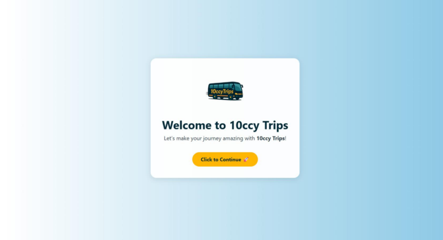 | 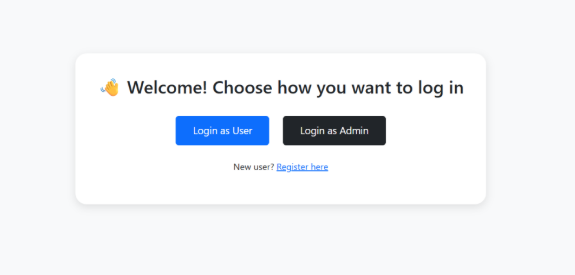 | 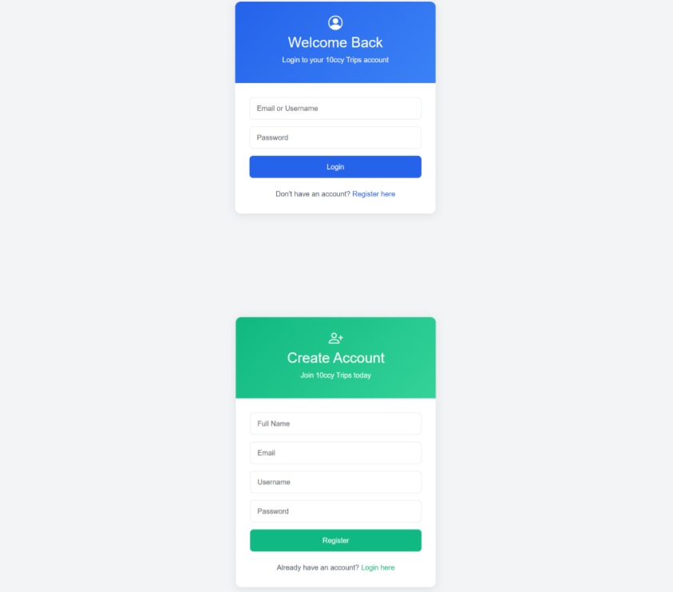 |

### 2. User Dashboard & Journey Search
| Passenger Dashboard | Search & Bus Fleet Listings |
| :---: | :---: |
| 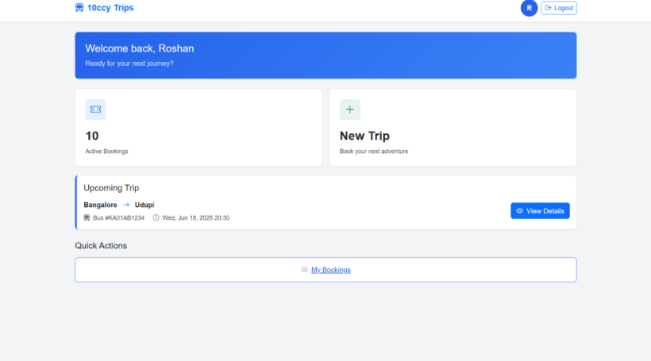 | 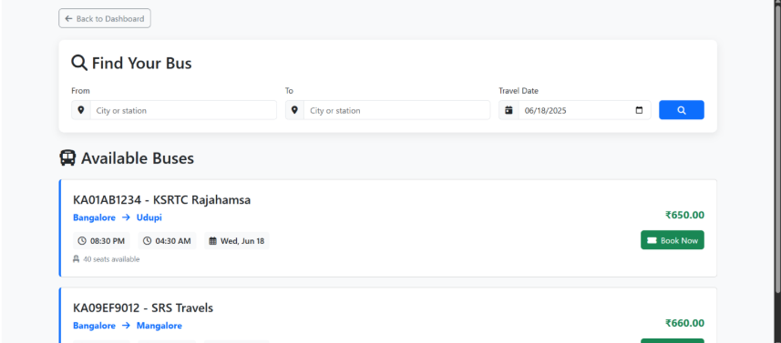 |

### 3. Interactive Seat Selection & Confirmation
| Interactive Seat Map & Passenger Details | Booking Confirmation Voucher |
| :---: | :---: |
| 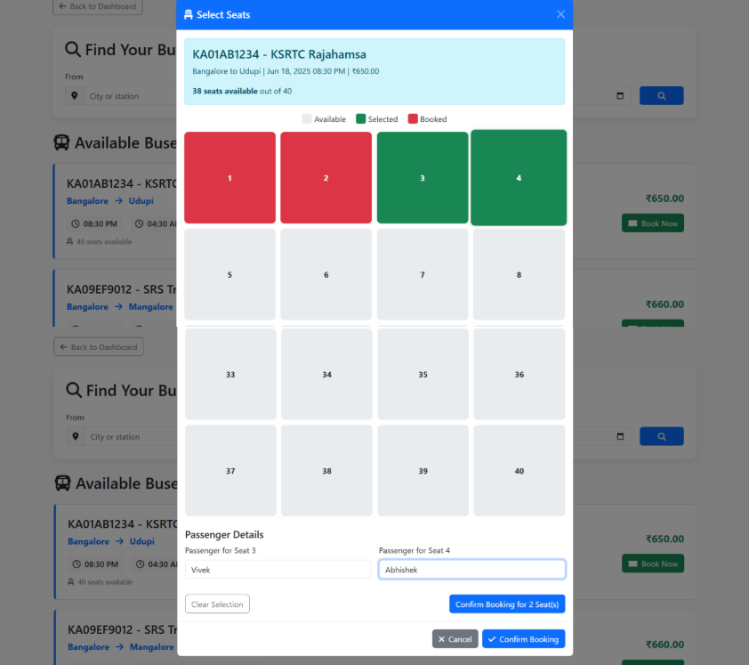 | 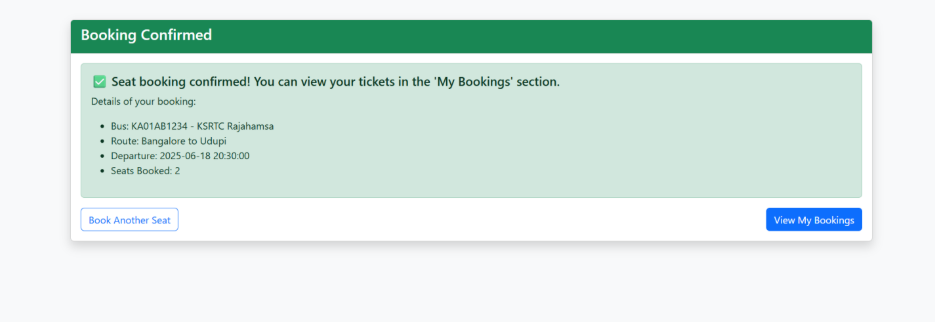 |

### 4. Digital E-Ticket & Travel History
| Electronic Travel Voucher (E-Ticket) | My Bookings History |
| :---: | :---: |
| 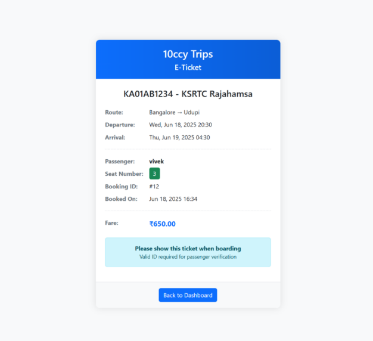 | 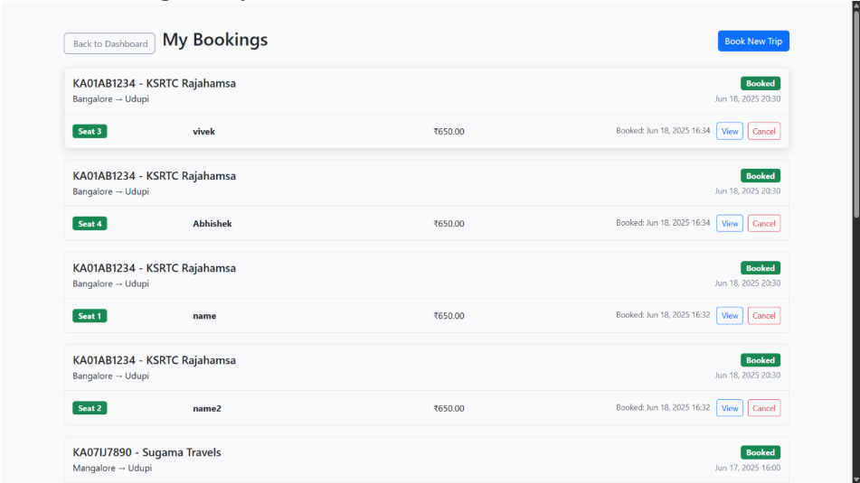 |

### 5. Fleet Administrator Control Center
| Admin Dashboard | Manage Schedules |
| :---: | :---: |
| 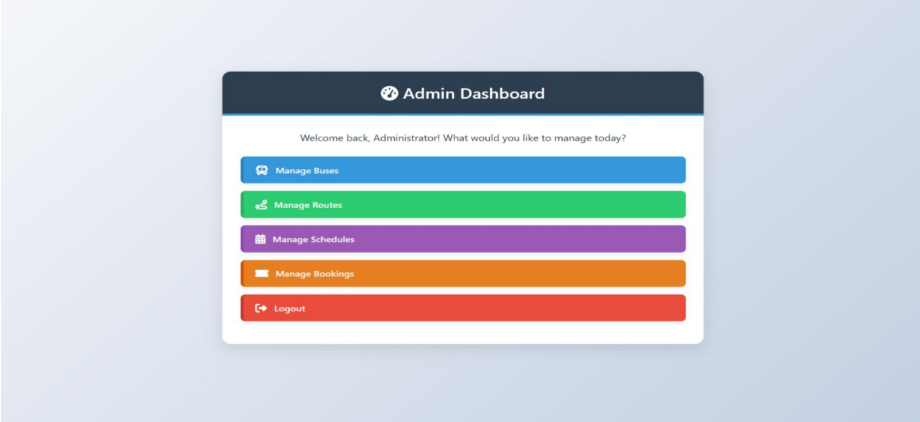 | 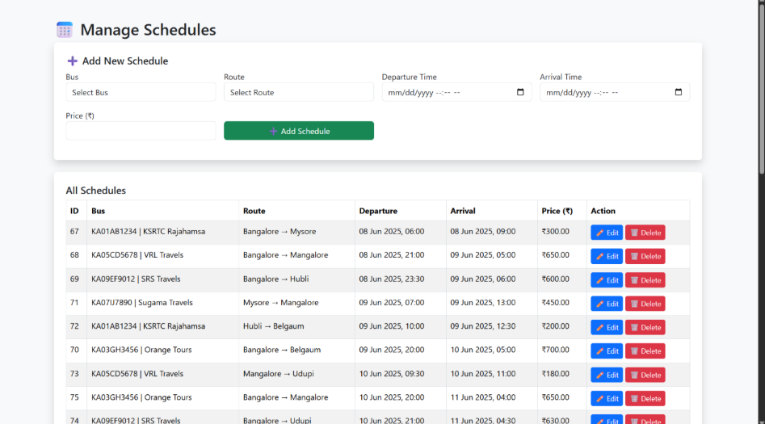 |

| Manage Routes | Manage Buses | Manage Bookings |
| :---: | :---: | :---: |
| 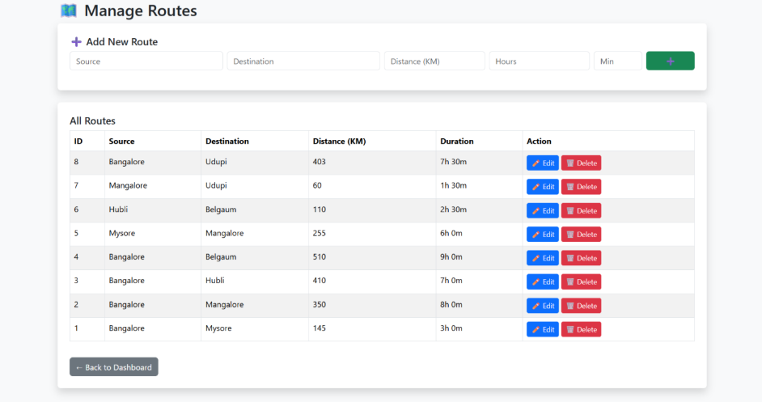 | 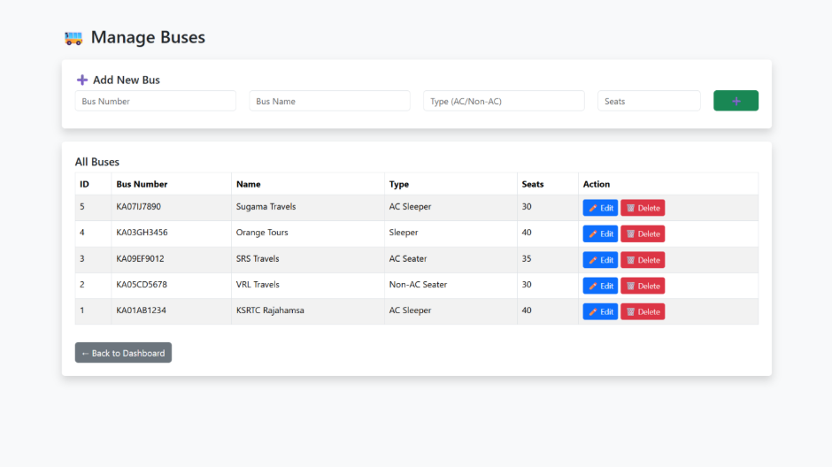 | 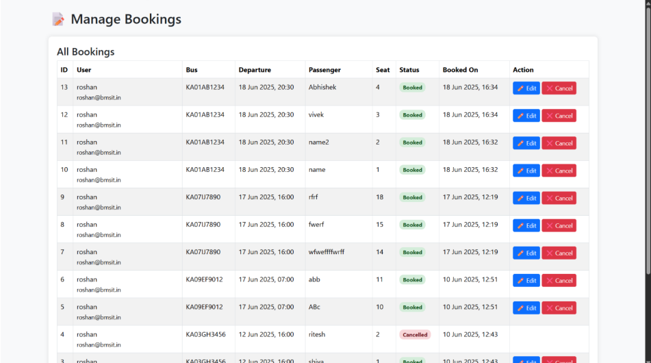 |

---

## 🛠️ Tech Stack

- **Backend**: PHP 8.x (Native Procedural & Object-Oriented with MySQLi)
- **Database**: MySQL 8.0 / MariaDB with Relational Foreign Key Integrity
- **Frontend**: HTML5, CSS3, JavaScript (ES6+), Bootstrap 5.3.3
- **Icons & Typography**: Bootstrap Icons, Font Awesome 6, Segoe UI
- **Security**: Password hashing (`bcrypt` via `password_hash()`), parameterized SQL statements, session role verification (`user` vs `admin`)

---

## 🗄️ Database Architecture

The system utilizes a normalized relational schema with cascading deletions and foreign key constraints:

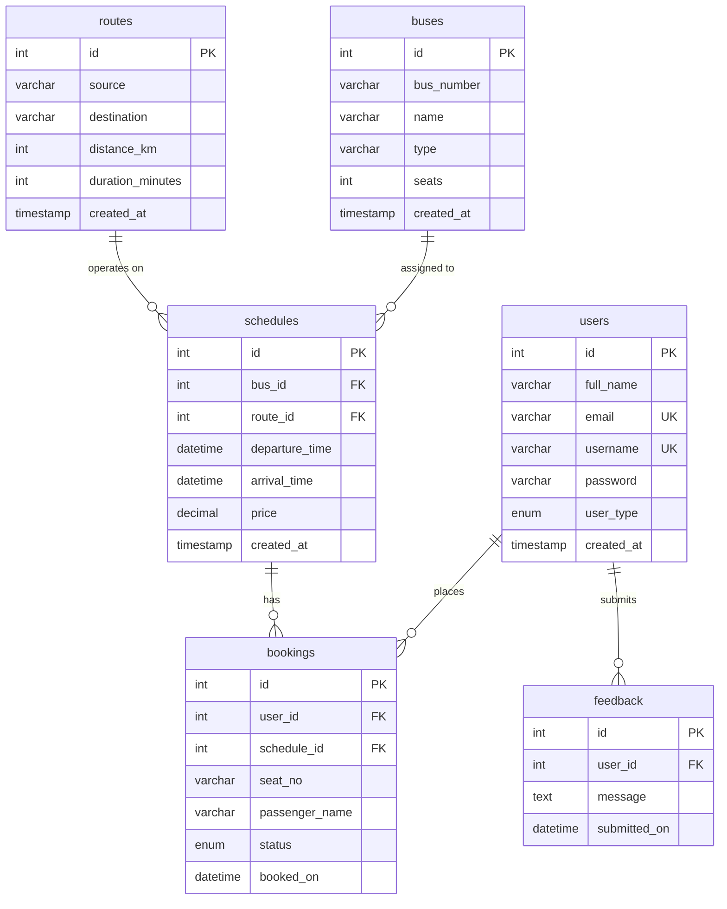

---

## 🚀 Getting Started

Follow these steps to set up the project locally on your machine.

### Prerequisites
- **Web Server**: Apache (XAMPP / WAMP) or PHP Built-in Server
- **PHP**: PHP 8.0 or newer (with `mysqli` and `session` extensions enabled)
- **Database**: MySQL 5.7+ / 8.0+ or MariaDB

### Step 1: Clone the Repository
```bash
git clone https://github.com/ritesh0w0/10ccy_trips.git
cd 10ccy_trips
```

### Step 2: Database Setup & Seeding
1. Open your MySQL client (phpMyAdmin, MySQL Workbench, or CLI).
2. Import the provided Indian Fleet seed file:
```bash
mysql -u root -p < seed_indian_data.sql
```
*(This automatically creates the `10ccy_trips` database and populates it with realistic Indian buses, routes like Bangalore–Udupi and Bangalore–Mangalore, active schedules, and demo accounts).*

### Step 3: Configure Database Connection
Verify the connection credentials in [`includes/db.php`](includes/db.php):
```php
<?php
$host = 'localhost';
$db   = '10ccy_trips';
$user = 'root';
$pass = ''; // Enter your local MySQL password if applicable

$conn = new mysqli($host, $user, $pass, $db);
if ($conn->connect_error) {
    die("Connection failed: " . $conn->connect_error);
}
?>
```

### Step 4: Run the Application
You can run it using your local server stack (e.g. XAMPP `htdocs`) or via the built-in PHP development server:
```bash
php -S localhost:8000
```
Open your browser and navigate to:
```
http://localhost:8000/index.php
```

---

## 🔑 Default Credentials

The seeded database comes pre-configured with the following test credentials:

| Role | Username / Identifier | Password | Access Level |
| :--- | :--- | :--- | :--- |
| **System Administrator** | `admin` | `admin123` | Full Fleet, Route, Schedule & Booking Admin Control |
| **Demo Passenger 1** | `roshan` (or `roshan@bmsit.in`) | `admin123` | Search, Book Seats, View E-Tickets, Cancel Trips |
| **Demo Passenger 2** | `ritesh0w0` (or `ritesh@10ccytrips.com`) | `admin123` | Search, Book Seats, View E-Tickets, Cancel Trips |

---

## 📂 Project Directory Structure

```text
10ccy_trips/
│
├── assets/                     # Frontend static assets
│   ├── logo.png                # Original 10ccy Trips brand bus logo
│   ├── screenshots/            # Original project report captures
│   └── style.css               # Global application stylesheet
│
├── docs/                       # Project documentation
│   └── screenshots/            # Visual documentation & preview captures
│       ├── 01_landing_page.png
│       ├── 02_login_choice.png
│       ├── 03_user_login.png
│       ├── 04_user_dashboard.png
│       ├── 05_bus_search.png
│       ├── 06_seat_selection.png
│       ├── 07_booking_confirmed.png
│       ├── 08_eticket.png
│       ├── 09_booking_history.png
│       ├── 10_admin_dashboard.png
│       ├── 11_manage_schedules.png
│       ├── 12_manage_routes.png
│       ├── 13_manage_buses.png
│       └── 14_manage_bookings.png
│
├── includes/                   # Reusable server-side modules
│   ├── db.php                  # MySQL database connection handler
│   ├── header.php              # Global layout header & navigation
│   └── footer.php              # Global footer template
│
├── admin_dashboard.php         # Admin control portal
├── admin_login.php             # Admin credential verification
├── book.php                    # Bus schedule search & fleet explorer
├── book_seats.php              # Seat reservation processor
├── booking_handler.php         # Booking transactional handler
├── booking_history.php         # Passenger trip history
├── cancel.php                  # Reservation cancellation handler
├── dashboard.php               # Passenger user dashboard
├── database.sql                # Base database schema
├── generate_hash.php           # Helper utility for bcrypt password hashing
├── index.php                   # Public landing page
├── load_seats.php              # Asynchronous seat layout builder
├── login-choice.php            # Portal selection (User vs Admin)
├── login.php                   # Passenger authentication
├── logout.php                  # Session termination
├── manage_bookings.php         # Admin booking management
├── manage_buses.php            # Admin fleet CRUD
├── manage_routes.php           # Admin intercity route CRUD
├── manage_schedules.php        # Admin timetable & fare manager
├── register.php                # Passenger self-registration
├── seed_indian_data.sql        # Database schema + authentic fleet seed dataset
├── ticket.php                  # Printable electronic travel voucher
├── .gitignore                  # Git tracking exclusion list (protects .env)
├── LICENSE                     # MIT License
└── README.md                   # Project documentation & visual guide
```

---

## 🔒 Security Best Practices

- **Credential Isolation**: `.env` and sensitive local configuration files are excluded via `.gitignore` to prevent secret exposure on remote repositories.
- **Prepared Statements**: Core database transactions employ parameterized queries to safeguard against SQL injection.
- **Session Segregation**: Separate session identifiers and role validations ensure user sessions cannot access administrative endpoints.

---

## 📜 License

This project is licensed under the [MIT License](LICENSE) - created by **[Ritesh Kulkarni](https://github.com/ritesh0w0)**.
